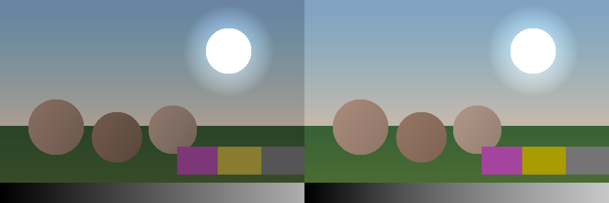
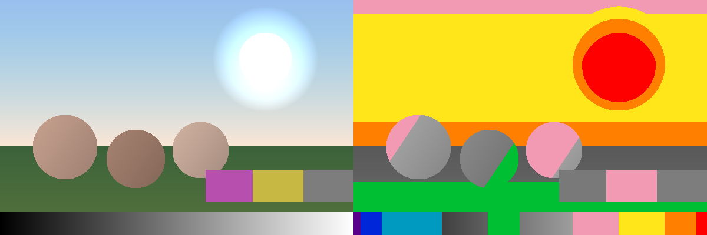
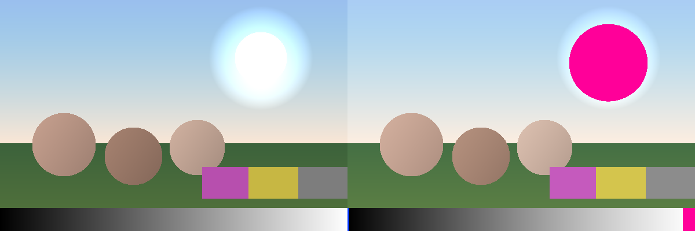
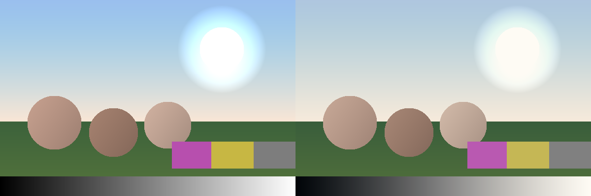
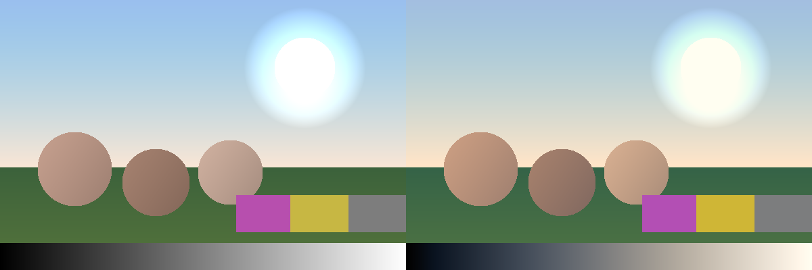
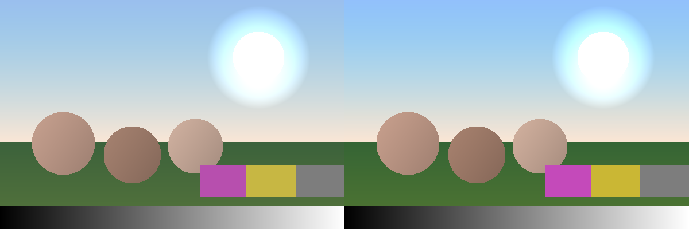
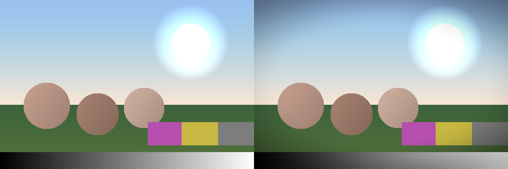

# Resolve DCTL Toolkit

Free, open-source DCTLs for DaVinci Resolve by **Behappystudiox** (BHS), made for video editors and colorists. MIT licensed: use them in client work, modify them, share them.

[**Download the latest release**](https://github.com/thehappycreative-dotcom/resolve-dctl-toolkit/releases/latest) or clone the repo.

## Tools

| Tool | Folder | What it does |
|---|---|---|
| **BHS Exposure Pro** | `dctl/exposure` | Exposure (stops), contrast + pivot, whites, highlights, midtones, shadows, blacks, highlight roll-off, saturation. Built-in False Color, Clipping Warning and Zone Mask views. |
| **BHS Film Print Look** | `dctl/looks` | Film-style tone curve, dye crosstalk, tinted shadows/highlights, highlight desaturation. |
| **BHS Split Tone** | `dctl/color` | Tint shadows and highlights with two hues while keeping brightness. |
| **BHS Skin Vibrance** | `dctl/color` | Boosts dull colors, leaves skin tones alone. |
| **BHS Vignette** | `dctl/effects` | Darken or lighten edges, with highlight protection. |

## BHS Pro pack (25 tools)

A full film-style toolset built on one shared color engine, in `dctl/pro`. Full documentation: **[docs/BHS_Pro_Guide.md](docs/BHS_Pro_Guide.md)**.

| Group | Tools |
|---|---|
| **Film** | A1 Film Lab (17 negative stocks x 6 print stocks), A2 Mono Film |
| **Looks** | B1 Looks (20 finished looks), B2 Inspo Looks, B3 Clean Lifestyle |
| **Density & color** | C1 Density, C2 Subtractive Saturation, C3 Color Separation, C4 Crosstalk |
| **Color tools** | D1 Vectors HSL, D2 Tetra, D3 Split Tone, D4 Skin Refine, D5 Film Curve, D6 Exposure and Balance |
| **Texture** | E1 Grain, E2 Halation, E3 Bloom and Mist, E4 Vignette |
| **Utility** | U1 False Color, U2 Scope Views, U3 Test Chart, U4 Gamut Compress, U5 Camera Input (14 camera log formats), U6 Display Output |

> Film stock and camera names are used only to describe the look and input format. This project is not affiliated with or endorsed by any film or camera manufacturer. Stock looks are tuned by eye, not measured from film scans.

## Previews

Rendered on a synthetic test scene (left = input, right = result). Settings used are in the DCTL defaults unless noted.

**Exposure Pro: underexposed shot fixed** (+1 stop, shadows +0.35, highlights -0.25, contrast 1.1, saturation 1.1)

**Exposure Pro: False Color view**

**Exposure Pro: Clipping Warning view** (+0.5 stop; magenta = clipped)

**Film Print Look**

**Split Tone**

**Skin Vibrance**

**Vignette**

## Install

1. In Resolve: **DaVinci Resolve > Open LUT Folder** (Mac) or the equivalent option in the Color page LUT menu.
2. Copy the `.dctl` files into that folder (a subfolder is fine).
3. **Color page > right-click a node > LUT > Refresh List**, then apply the DCTL from the LUT list.

> DCTL support requires DaVinci Resolve Studio.

## Exposure Pro quick start

1. Put it on its own node before your look.
2. Set **Input Space** to match the footage (Linear, Gamma24, or DaVinciInt).
3. Set **View Mode** to *FalseColor* and adjust Exposure until skin and mid-grey sit where you want them; use *ClipWarning* to protect highlights and blacks.
4. Set View Mode back to **Off**.

## Contributing

Issues and pull requests are welcome. Bug reports with the Resolve version and the footage's color space help most.

## License

[MIT](LICENSE)
